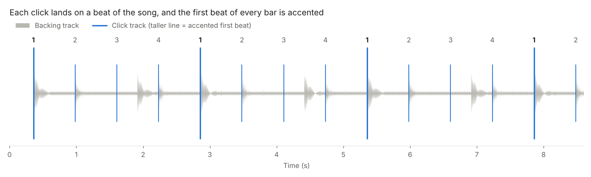

# click_track

**Create a click track aligned on every song of a folder — ready to drop into your DAW.**
**Créez une piste clic calée sur chaque morceau d'un dossier, prête à glisser dans votre logiciel audio.**



[English](#english) · [Français](#français)

---

## English

`click_track.py` is a single Python script that writes a metronome track (`My Song_click.wav`) for every song in a folder. The click follows the song's own tempo and beats: no need to know the BPM or to line anything up by hand. It was written for singers and musicians who rehearse or perform over backing tracks and want a separate click in GarageBand, Logic, Reaper, Ableton Live or any other DAW.

### Features

- **Automatic tempo and beat detection.** The beat grid is fitted on the whole song to a fraction of a BPM, so the click does not drift, even after five minutes.
- **Variable tempo handled.** When a song speeds up or slows down, the click follows it beat by beat.
- **Starts on the right beat.** The grid is placed on the start of the music, including on syncopated or shuffle songs, where off-beats are often louder than the beats.
- **Accented "one".** The first beat of every bar is a higher-pitched, louder click. The very first click is the "one" (adjustable).
- **Drop-in file.** The click file is exactly as long as the song, with silence before the first beat: put it at the very start of a new track and it is in sync.
- **Per-song settings** in `click_settings.txt`, created automatically: one line per song with the detected tempo. Edit a line to fix a song; it is never overwritten.
- **Safe to re-run.** Existing click files are kept, a Ctrl+C stops cleanly at any time and never leaves a half-written file.
- **Bilingual interface** (English / French), chosen from the system language.
- Reads WAV, MP3, FLAC, M4A, OGG and AIFF.

### Installation

1. **Python 3.9 or later**: [python.org](https://www.python.org/downloads/).
2. **Python packages:**
   ```
   pip install -r requirements.txt
   ```
3. **Optional: ffmpeg**, only if some files fail to load (M4A/AAC in particular).
   - Windows: `winget install Gyan.FFmpeg`
   - macOS: `brew install ffmpeg`
   - Linux: `sudo apt install ffmpeg`

### Quick start

```
python click_track.py "D:\Backing tracks"
```

Run it without arguments for the built-in help. Each song is analysed in about 20 seconds. The output looks like this:

```
  My Song.wav
     tempo = 109.00 BPM | 292 beats | 1st click at 0.143 s | length 162.65 s | 48000 Hz
     grid moved by 1/2 beat onto the start of the music (0.070 s)  (--shift 0 to cancel)
     other possible pulses: 72.7  (→ --bpm to force one)
     -> D:\Backing tracks\clicks\My Song_click.wav
```

Then, in your DAW, import `clicks\My Song_click.wav` on its own track, at position 0.

**Check by ear:** add `--preview` to also get `My Song_preview.wav`, the song mixed with its click.

### Files

| File | Role |
|---|---|
| `My Song.wav` (or .mp3, .flac…) | the song |
| `clicks/My Song_click.wav` | the click track, created by the script (24-bit WAV, same sample rate and length as the song) |
| `clicks/My Song_preview.wav` | song + click, with `--preview` |
| `click_settings.txt` | per-song settings, created on the first run |

### Fixing a song

Most songs are right on the first run. When one is not, add options on its line in `click_settings.txt`, then run the script again with `--overwrite`:

```
My Song = --bpm 82.38 --beat-at 00:29.2
```

| What you hear | Fix |
|---|---|
| The click is twice too fast or too slow | `--half` or `--double` |
| The click is right but feels "between" the beats | `--shift 1/2` (or `1/3`, `2/3` on a shuffle) |
| The accent is not on the "one" | `--accent-offset 1` (or 2, 3) |
| Nothing works | `--beat-at 00:29.2`: the time of a "one" you hear clearly; the grid and the accent are aligned on it |
| The click is slightly early or late | `--offset-ms 20` (later) or `--offset-ms -20` (earlier) |
| The song is in 3/4 | `--beats-per-bar 3` |

The name on the left can be the full file name or a part of it ("My Song" is enough). Delete a line to have the song detected again.

### Options

Global options (command line only):

| Option | Effect |
|---|---|
| `--overwrite` | recreate existing click files (by default they are never overwritten; `click_settings.txt` never is) |
| `--preview` | also write a song + click mix |
| `-o FOLDER` | output folder (default: `clicks` next to the songs) |
| `--settings FILE` | use another settings file |
| `--no-settings` | do not create or update `click_settings.txt` |
| `--fr` / `--en` | force the interface language |

Per-song options (command line, or a song's line in `click_settings.txt`):

| Option | Effect |
|---|---|
| `--bpm 85` | force the tempo (refined automatically within ±1 %) |
| `--half` / `--double` | tempo divided / multiplied by 2, keeping the same "one" |
| `--beat-at 00:29.350` | time of a "one" found by ear (also `29.35`) |
| `--shift 1/2` | move the grid by a fraction of a beat; `--shift 0` cancels the automatic realignment |
| `--offset-ms -10` | move all clicks, in milliseconds |
| `--accent-offset 1` | move the accent by 1, 2 or 3 beats |
| `--accent-auto` | find the "one" from chord changes instead of using the first click |
| `--beats-per-bar 3` | beats per bar (default 4) |
| `--count-in 1` | bars of count-in before the music |
| `--fixed` / `--adaptive` | force a regular grid / beat-by-beat tracking (by default the script decides) |
| `--accent-freq`, `--click-freq`, `--volume` | click sound |

### Notes

- Designed for songs with a beat (pop, rock, electro…). Free-tempo passages (rubato intros, a cappella breaks) cannot be followed reliably.
- Tested on Windows 11 and Linux. macOS should work but has not been tested.

### License

GNU General Public License v3.0 or later — see [LICENSE](LICENSE).

---

## Français

`click_track.py` est un script Python unique qui écrit une piste métronome (`My Song_click.wav`) pour chaque morceau d'un dossier. Le clic suit le tempo et les temps du morceau lui-même : inutile de connaître le BPM ou de caler quoi que ce soit à la main. Il a été écrit pour les chanteurs et musiciens qui répètent ou jouent sur des pistes d'accompagnement et veulent un clic séparé dans GarageBand, Logic, Reaper, Ableton Live ou tout autre logiciel audio.

### Fonctionnalités

- **Détection automatique du tempo et des temps.** La grille est ajustée sur tout le morceau, à une fraction de BPM près : le clic ne dérive pas, même au bout de cinq minutes.
- **Tempo variable pris en charge.** Quand un morceau accélère ou ralentit, le clic le suit temps par temps.
- **Démarrage sur le bon temps.** La grille est posée sur le début de la musique, y compris sur les morceaux syncopés ou en shuffle, où les contretemps frappent souvent plus fort que les temps.
- **« Un » accentué.** Le premier temps de chaque mesure est un clic plus aigu et plus fort. Le tout premier clic est le « un » (réglable).
- **Fichier prêt à poser.** Le fichier clic a exactement la durée du morceau, avec du silence avant le premier temps : posé au tout début d'une nouvelle piste, il est calé.
- **Réglages par morceau** dans `click_settings.txt`, créé automatiquement : une ligne par morceau avec le tempo détecté. Modifiez une ligne pour corriger un morceau ; elle n'est jamais écrasée.
- **Relançable sans risque.** Les fichiers clic existants sont conservés ; un Ctrl+C arrête proprement à tout moment et ne laisse jamais de fichier à moitié écrit.
- **Interface bilingue** (français / anglais), choisie selon la langue du système.
- Lit les formats WAV, MP3, FLAC, M4A, OGG et AIFF.

### Installation

1. **Python 3.9 ou plus récent** : [python.org](https://www.python.org/downloads/).
2. **Paquets Python :**
   ```
   pip install -r requirements.txt
   ```
3. **Facultatif : ffmpeg**, seulement si certains fichiers ne se chargent pas (M4A/AAC en particulier).
   - Windows : `winget install Gyan.FFmpeg`
   - macOS : `brew install ffmpeg`
   - Linux : `sudo apt install ffmpeg`

### Démarrage rapide

```
python click_track.py "D:\Mes instrus"
```

Lancé sans argument, le script affiche son aide. Chaque morceau est analysé en une vingtaine de secondes. Le résultat ressemble à ceci :

```
  My Song.wav
     tempo = 109.00 BPM | 292 temps | 1er clic à 0.143 s | durée 162.65 s | 48000 Hz
     grille recalée de 1/2 temps sur le début de la musique (0.070 s)  (--shift 0 pour annuler)
     autres pulsations possibles : 72.7  (→ --bpm pour forcer)
     -> D:\Mes instrus\clicks\My Song_click.wav
```

Dans votre logiciel audio, importez ensuite `clicks\My Song_click.wav` sur une piste à part, à la position 0.

**Vérification à l'oreille :** ajoutez `--preview` pour obtenir aussi `My Song_preview.wav`, le morceau mixé avec son clic.

### Fichiers

| Fichier | Rôle |
|---|---|
| `My Song.wav` (ou .mp3, .flac…) | le morceau |
| `clicks/My Song_click.wav` | la piste clic créée par le script (WAV 24 bits, même fréquence d'échantillonnage et même durée que le morceau) |
| `clicks/My Song_preview.wav` | morceau + clic, avec `--preview` |
| `click_settings.txt` | les réglages par morceau, créé au premier passage |

### Corriger un morceau

La plupart des morceaux sont justes du premier coup. Sinon, ajoutez des options sur la ligne du morceau dans `click_settings.txt`, puis relancez le script avec `--overwrite` :

```
My Song = --bpm 82.38 --beat-at 00:29.2
```

| Ce que vous entendez | Correction |
|---|---|
| Le clic est deux fois trop rapide ou trop lent | `--half` ou `--double` |
| Le clic est régulier mais tombe « entre » les temps | `--shift 1/2` (ou `1/3`, `2/3` sur un shuffle) |
| L'accent n'est pas sur le « un » | `--accent-offset 1` (ou 2, 3) |
| Rien ne va | `--beat-at 00:29.2` : l'instant d'un « un » bien audible ; la grille et l'accent sont calés dessus |
| Le clic est légèrement en avance ou en retard | `--offset-ms 20` (plus tard) ou `--offset-ms -20` (plus tôt) |
| Le morceau est en 3/4 | `--beats-per-bar 3` |

Le nom à gauche peut être le nom complet du fichier ou une partie (« My Song » suffit). Supprimez une ligne pour que le morceau soit de nouveau détecté.

### Options

Options globales (ligne de commande uniquement) :

| Option | Effet |
|---|---|
| `--overwrite` | recrée les fichiers clic existants (par défaut, ils ne sont jamais écrasés ; `click_settings.txt` ne l'est jamais) |
| `--preview` | écrit aussi un mix morceau + clic |
| `-o DOSSIER` | dossier de sortie (par défaut : `clicks` à côté des morceaux) |
| `--settings FICHIER` | utilise un autre fichier de réglages |
| `--no-settings` | ne crée ni ne complète `click_settings.txt` |
| `--fr` / `--en` | force la langue de l'interface |

Options par morceau (ligne de commande, ou ligne du morceau dans `click_settings.txt`) :

| Option | Effet |
|---|---|
| `--bpm 85` | impose le tempo (affiné automatiquement à ±1 %) |
| `--half` / `--double` | tempo divisé / multiplié par 2, en gardant le même « un » |
| `--beat-at 00:29.350` | instant d'un « un » repéré à l'oreille (ou `29.35`) |
| `--shift 1/2` | décale la grille d'une fraction de temps ; `--shift 0` annule le recalage automatique |
| `--offset-ms -10` | décale tous les clics, en millisecondes |
| `--accent-offset 1` | décale l'accent de 1, 2 ou 3 temps |
| `--accent-auto` | cherche le « un » d'après les changements d'accords au lieu du premier clic |
| `--beats-per-bar 3` | temps par mesure (4 par défaut) |
| `--count-in 1` | mesures de décompte avant la musique |
| `--fixed` / `--adaptive` | force une grille régulière / un suivi temps par temps (par défaut, le script choisit) |
| `--accent-freq`, `--click-freq`, `--volume` | son du clic |

### Remarques

- Conçu pour les morceaux rythmés (pop, rock, électro…). Les passages sans tempo fixe (introductions rubato, passages a cappella) ne peuvent pas être suivis de façon fiable.
- Testé sous Windows 11 et Linux. macOS devrait fonctionner mais n'a pas été testé.

### Licence

GNU General Public License v3.0 ou ultérieure : voir [LICENSE](LICENSE).
